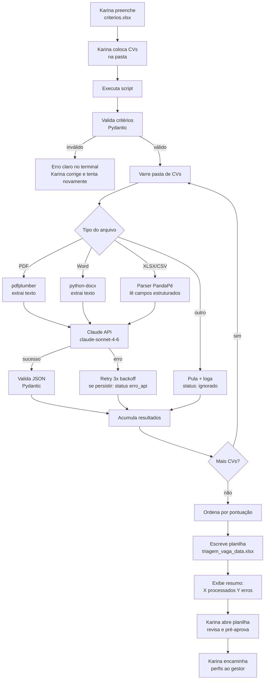

# AUTOMATION_FLOWS — fast-triagem-rh

> Detalhe dos fluxos da automação. Gerado em 2026-05-06.

---

## Fluxo 1 — Triagem de Candidatos por Vaga

### Gatilho

**Manual** — Karina executa quando tem uma leva de CVs para triar.

```bash
python -m fast_triagem_rh --vaga criterios.xlsx --cvs pasta/cvs/
```

- `criterios.xlsx` — template preenchido por Karina com os critérios da vaga
- `pasta/cvs/` — pasta com PDFs, Word e/ou exportação do PandaPé

### Etapas



**Sequência detalhada:**

1. **Validação de critérios** — lê `criterios.xlsx`, monta `VagaCriterios` via Pydantic. Falha imediata com mensagem legível se algum campo obrigatório estiver ausente.
2. **Varredura da pasta** — lista todos os arquivos; classifica por extensão (`.pdf`, `.docx`, `.doc`, `.xlsx`, `.csv`).
3. **Extração de texto** — por arquivo:
   - PDF: `pdfplumber.open()` → extrai páginas → concatena texto
   - Word: `python-docx Document()` → extrai parágrafos → concatena texto
   - PandaPé export: lê colunas mapeadas → monta texto estruturado por candidato
   - Outros: loga como ignorado, não para execução
4. **Análise com IA** — para cada candidato, monta prompt com critérios + texto do CV, chama `claude-sonnet-4-6`, aguarda JSON estruturado.
5. **Retry em falha de API** — Tenacity: 3 tentativas, backoff exponencial (2s, 4s, 8s). Se persistir, registra `ResultadoCandidato` com `classificacao="erro_api"`.
6. **Validação do response** — Pydantic valida JSON retornado pela IA. Se inválido, trata como `erro_api`.
7. **Ordenação** — candidatos aprovados primeiro, depois `verificar`, depois `reprovados`, ordenados por pontuação dentro de cada grupo.
8. **Escrita do Excel** — `openpyxl` cria `triagem_<cargo>_<YYYYMMDD_HHMMSS>.xlsx` com uma linha por candidato.
9. **Resumo final** — imprime no terminal: total processados, aprovados, verificar, reprovados, erros.

### Uso de IA

- **Modelo:** `claude-sonnet-4-6`
- **Prompt:** versionado em `prompts/triagem_v1.md`
- **O que faz:** lê texto livre do CV + critérios da vaga → classifica candidato → extrai contato → lista pontos positivos e negativos → escreve justificativa

### Integrações

| Sistema | O que envia/recebe |
|---|---|
| Sistema de arquivos local | Lê CVs (PDF/Word) e exportação PandaPé |
| Claude API (Anthropic) | Envia prompt com CV + critérios; recebe JSON com análise |
| Excel (openpyxl) | Escreve planilha de resultado ranqueada |

### Saídas

`triagem_<cargo>_<YYYYMMDD_HHMMSS>.xlsx` com as colunas:

| Coluna | Conteúdo |
|---|---|
| Nome | Extraído do CV pela IA |
| Contato | Email e/ou telefone extraído do CV |
| Classificação | aprovado / verificar / reprovado / erro_parsing / erro_api |
| Pontuação | 0–100 (maior = mais aderente) |
| Pontos Positivos | Lista separada por quebra de linha |
| Pontos Negativos | Lista separada por quebra de linha |
| Justificativa | 2–3 frases da IA |
| Arquivo Fonte | Nome do arquivo original |
| Data Triagem | Timestamp da execução |

### Aprovação humana (HITL)

**Obrigatória.** Karina abre a planilha gerada, revisa os candidatos classificados como `aprovado` e `verificar`, e decide quais encaminhar ao gestor. A automação nunca envia nada diretamente.

Sem timeout — Karina revisa no seu próprio ritmo.

### Tratamento de erros

| Erro | Comportamento |
|---|---|
| `criterios.xlsx` inválido ou ausente | Para imediatamente, mensagem clara no terminal |
| Pasta de CVs vazia ou inexistente | Para imediatamente, mensagem clara |
| PDF ilegível / escaneado / protegido | Pula, loga, inclui na planilha com `classificacao="erro_parsing"` |
| Falha na Claude API | Retry 3x com backoff. Se persistir: `classificacao="erro_api"` na planilha |
| JSON inválido retornado pela IA | Trata como `erro_api`, loga o response bruto para debug |
| Falha ao escrever Excel | Loga erro crítico, exibe mensagem pedindo para verificar permissões da pasta |

**Fallback manual:** se a automação falhar completamente, Karina usa o processo manual atual. A automação não é bloqueante para o trabalho.

---

## Mudanças nesta versão

### 2026-05-06
- Versão inicial gerada após `/planejar-automacao`
