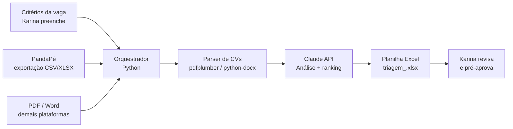

# SOLUTION_DESIGN — fast-triagem-rh

## Mudanças nesta versão

### 2026-05-06
- Arquitetura detalhada após sessão de `/planejar-automacao`
- Confirmado: saída em Excel (openpyxl), não Google Sheets
- Input de critérios: template Excel (não YAML) — mais acessível para Karina
- Modelo de IA: claude-sonnet-4-6
- Parser PandaPé: a implementar após receber arquivo de exportação real
- Prompt v1 documentado em `prompts/triagem_v1.md`

---

> Arquitetura detalhada em `/planejar-automacao`. Gerado em 2026-05-06, atualizado em 2026-05-06.

## Visão geral



## Stack escolhida

| Camada | Tecnologia | Por quê |
|---|---|---|
| Runtime | Python 3.11+ | Bibliotecas de PDF/Word/Excel, já no starter |
| Parsing de CV | pdfplumber + python-docx | Extração de texto de PDF e Word |
| IA | Claude API (Anthropic) | Análise semântica de CVs contra critérios |
| Planilha | openpyxl (Excel local) | Arquivo .xlsx que Karina abre direto; sem dependência de credenciais Google |
| Agendamento | Manual (trigger por comando) | Karina roda por demanda, sem schedule |
| Validação | Pydantic | Critérios da vaga como modelo tipado |
| Logs | Loguru (já no starter) | JSON em prod, console em dev |

## Fluxo detalhado (MVP)

### 1. Input — Critérios da vaga
Karina preenche um template Excel (`criterios.xlsx`, gerado por `scripts/gerar_template_criterios.py`) com:
- `cargo`: título da vaga
- `requisitos_obrigatorios`: lista de itens eliminatórios
- `diferenciais`: lista de itens que pesam positivamente
- `localizacao`: cidade/estado aceitos
- `tipo_contrato`: CLT, PJ, híbrido, etc.
- `observacoes`: texto livre adicional

### 2. Coleta de CVs
- **PandaPé:** Karina exporta CSV/XLSX com dados dos candidatos + links ou arquivos de CV.
- **Demais plataformas:** Karina faz download dos PDFs/Word e joga numa pasta local.

### 3. Parsing
Para cada CV:
- PDF → `pdfplumber` extrai texto
- Word → `python-docx` extrai texto
- Exportação PandaPé → lê campos estruturados do CSV/XLSX

### 4. Análise com IA
Prompt enviado à Claude API por candidato:
```
Você é um assistente de triagem de candidatos.

Vaga: {cargo}
Requisitos obrigatórios: {requisitos}
Diferenciais: {diferenciais}
Localização aceita: {localizacao}

Currículo:
{texto_cv}

Retorne um JSON com:
- classificacao: "aprovado" | "reprovado" | "verificar"
- pontuacao: 0–100
- pontos_positivos: lista
- pontos_negativos: lista
- justificativa: texto curto (2–3 frases)
- contato: email e telefone extraídos do CV
```

### 5. Output — Planilha
Linha gerada por candidato na planilha:
| Nome | Contato | Classificação | Pontuação | Pontos Positivos | Pontos Negativos | Justificativa | Fonte | Data |

## Decisões de arquitetura

- **Critérios como template Excel por vaga:** mais acessível que YAML ou formulário web para a Karina (não-técnica); ela duplica o arquivo de uma vaga anterior como base. A ser validado no treinamento.
- **Sem banco de dados no MVP:** resultados vão direto pra planilha. Logs locais são suficientes pra rastrear runs.
- **Human-in-the-loop explícito:** automação nunca envia nada ao gestor. Karina valida a planilha antes de qualquer ação.

## Integrações

| Sistema | Direção | O que troca | Frequência |
|---|---|---|---|
| PandaPé | Leitura | CSV/XLSX de candidatos | Por vaga |
| PDF/Word local | Leitura | Texto dos CVs | Por vaga |
| Claude API | Leitura+escrita | Prompt + resposta JSON | Por candidato |
| Planilha Excel (local) | Escrita | Linha por candidato no .xlsx | Por run |

## Pontos críticos

- **Qualidade do parsing de PDF:** CVs com formatação complexa, tabelas ou fontes não-padrão podem gerar texto ilegível. Mitigação: log de confiança de extração + flag para revisão manual.
- **Critérios mal preenchidos:** lixo entra, lixo sai. Mitigação: template de critérios + validação Pydantic antes de rodar.
- **Custo de API:** muitos candidatos = muitas chamadas. Mitigação: estimar custo antes de rodar lotes grandes.

## Segurança

- **Credenciais:** `.env` local (não commitado). Variável: `ANTHROPIC_API_KEY`.
- **Dados sensíveis:** CVs geralmente não têm dados críticos. LGPD a tratar em versão futura.
- **Acessos:** só Clara e Karina têm acesso ao repositório e à planilha.

## Observabilidade

- **Logs:** Loguru estruturado. Por candidato: arquivo processado, resultado da IA, status de escrita na planilha.
- **Erros:** CVs que falharam no parsing ou na API ficam logados com nome do arquivo e motivo.
- **Sem alertas no MVP:** volume pequeno, Karina vê o resultado diretamente.

## Plano de evolução

| Fase | O que adiciona |
|---|---|
| MVP | Fluxo completo manual: Karina coleta CVs → roda script → revisa planilha |
| Fase 2 | API PandaPé direta (sem exportação manual) |
| Fase 3 | APIs Indeed, LinkedIn, Catho (quando disponíveis) |
| Fase 4 | Sugestão de perguntas de entrevista por candidato |
| Fase 5 | Relatório automático para gestores |
| Evolução LGPD | Detecção e anonimização de dados sensíveis em CVs |

---

## Mudanças nesta versão

### 2026-05-06
- Versão inicial gerada após kickoff com Clara Barbosa
- Arquitetura hipotética — detalhar em `/planejar-automacao`
