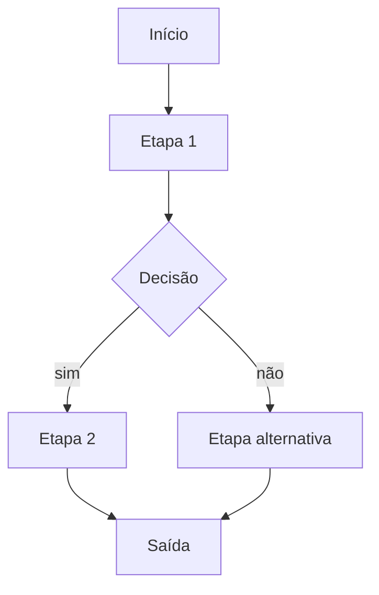

# AUTOMATION_FLOWS

> Detalhe de cada fluxo da automação. Saída do `/planejar-automacao`.

## Fluxo 1 — [nome do fluxo]

### Gatilho
[cron / webhook / manual / evento de outro sistema]

Detalhes do agendamento, payload esperado, ou comando de execução manual.

### Etapas

1. **[Etapa 1]** — [o que faz]
2. **[Etapa 2]** — [o que faz]
3. **[Etapa N]** — [o que faz]

### Uso de IA

- **Modelo:** [claude-sonnet-4 / claude-haiku / outro]
- **Prompt:** versionado em `prompts/[nome].md`
- **O que faz:** [classificação / extração / geração]

### Integrações usadas

| Sistema | O que envia/recebe |
|---|---|
| | |

### Saídas

[O que essa automação produz — arquivos, registros em banco, mensagens, etc.]

### Aprovação humana (HITL)

[Se algum passo precisa de aprovação humana antes de executar — onde, como, timeout.]

### Tratamento de erros

[O que acontece se cada etapa falhar — retry, DLQ, alerta, fallback manual.]

---

## Fluxo 2 — [nome]

[mesma estrutura]

---

## Mudanças nesta versão

### YYYY-MM-DD
- [mudança]
