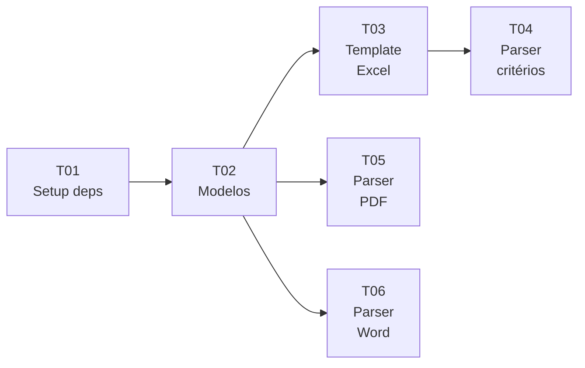

# Guia Detalhado — Dia Um

> Setup de dependências e parsers. Depois desse dia, você tem a fundação técnica para ler CVs em PDF, Word e critérios em Excel.

**Data:** 2026-05-06  
**Tempo estimado:** 8h de trabalho (pode ser distribuído em 1-2 dias)  
**Saída esperada:** Todos os parsers testados e validados com arquivos reais

---

## Overview do Dia Um



Você vai fazer 6 tarefas que se empilham assim:
1. **T01** (30 min): adicionar bibliotecas — tudo começa daqui.
2. **T02** (1h): definir a estrutura de dados (modelos Pydantic) — diz como um CV e critérios se parecem em código.
3. **T03** (30 min): criar o template Excel que Karina vai usar — simples, copiável, sem jargão.
4. **T04** (1h): ler esse Excel e transformar em código — cria segurança: se Karina errar, você avisa.
5. **T05** (2h): extrair texto de PDF — o tipo mais comum de CV.
6. **T06** (1.5h): extrair texto de Word — o segundo mais comum.

No final: você tem 4 parsers prontos (Excel, PDF, Word, + pronto para PandaPé depois).

---

## Pré-requisitos

Antes de começar, confirme que você tem:

- [ ] `ANTHROPIC_API_KEY` em `.env` (será preciso depois, mas já adiciona agora)
- [ ] Python 3.11+ instalado (`python --version`)
- [ ] `uv` ou `pip` funcionando (`pip --version`)
- [ ] Um editor aberto no projeto (VS Code recomendado)
- [ ] Ter rodado `make install` ou equivalente após clonar o template

Se alguma coisa acima não estiver pronta, resolva antes de começar.

---

# T01 — Setup de dependências (30 min)

## O que é

Adicionar as 4 bibliotecas principais ao `pyproject.toml`:
- **anthropic** — para falar com a Claude API (virá depois, mas já deixa pronto)
- **pdfplumber** — extrai texto de PDF
- **python-docx** — extrai texto de Word
- **openpyxl** — lê e escreve Excel

## Por que é importante

Sem essas libs instaladas, os próximos passos não rodam. É o alicerce.

## Como fazer

### Passo 1: Abrir o arquivo

Abra [pyproject.toml](../../pyproject.toml) na raiz do projeto.

Procure a seção `[project]` → `dependencies`. Deve estar assim hoje:

```toml
dependencies = [
    "loguru>=0.7.0",
]
```

### Passo 2: Adicionar as dependências

Adicione as 4 libs nessa lista:

```toml
dependencies = [
    "loguru>=0.7.0",
    "anthropic>=0.41.1",      # Claude API
    "pdfplumber>=0.11.0",     # Parse PDF
    "python-docx>=1.0.0",     # Parse Word
    "openpyxl>=3.10.0",       # Read/write Excel
    "pydantic>=2.0.0",        # Validação de dados (provavelmente já tá)
]
```

**Dicas de versão:**
- Use `>=` (mínimo) em vez de `==` (exato). Deixa margem pra updates menores.
- Se o projeto já tiver `pydantic`, não adiciona de novo.

### Passo 3: Instalar localmente

Rode um dos dois:

```bash
# Se estiver usando uv (recomendado)
uv pip install -e .

# Ou se estiver usando pip direto
pip install -e .
```

Isso vai baixar e instalar tudo. Vai demorar uns 30-60 segundos.

### Passo 4: Validar

Abra o terminal Python e rode:

```bash
python -c "import anthropic; import pdfplumber; import docx; import openpyxl; print('✓ Tudo OK!')"
```

Se não reclamar e imprimir `✓ Tudo OK!`, você passou.

Se alguma lib faltar, vai dar `ModuleNotFoundError`. Se acontecer, rode `pip install` novamente e tenta de novo.

## Checklist de T01

- [ ] Adicionou 4 libs ao `pyproject.toml`
- [ ] Rodou `pip install -e .` sem erro
- [ ] Testou importação no Python REPL
- [ ] Commit feito: `chore: adicionar dependências principais`

---

# T02 — Modelos Pydantic (1h)

## O que é

Criar um arquivo Python que define a "forma" de dois objetos:
1. **VagaCriterios** — o que Karina entra (critérios da vaga)
2. **ResultadoCandidato** — o que sai (resultado da análise de um CV)

Isso garante que:
- O código sabe exatamente qual campo é obrigatório, qual é lista, qual é número.
- Se alguém passar dado errado (ex: pontuação = 150 em vez de 0–100), Python avisa.
- A IA sabe que tipo de objeto espera na resposta.

## Por que é importante

Sem isso, você coloca strings e números aleatórios por toda parte, fica confuso. Com isso, há uma "contrato" entre as partes.

## Estrutura esperada

Crie o arquivo [src/fast_triagem_rh/models.py](../../src/fast_triagem_rh/models.py).

### Passo 1: VagaCriterios

Esse modelo representa um formulário que Karina preenche. Campos:

| Campo | Tipo | Obrigatório | Exemplo |
|---|---|---|---|
| `cargo` | string | ✓ | "Engenheiro de Software" |
| `requisitos_obrigatorios` | list[string] | ✓ | ["5 anos Python", "Experiência com API"] |
| `diferenciais` | list[string] | ✓ (pode ser vazio) | ["AWS", "Docker", "SQL"] |
| `localizacao` | string | ✓ | "São Paulo, SP" |
| `tipo_contrato` | string | ✓ | "CLT" \| "PJ" \| "Híbrido" |
| `observacoes` | string | ✗ (opcional) | "Pode ser remoto parcialmente" |

### Passo 2: ResultadoCandidato

Esse modelo representa uma linha da planilha final. Campos:

| Campo | Tipo | Obrigatório | Exemplo |
|---|---|---|---|
| `nome` | string | ✓ | "João Silva" |
| `contato` | string | ✓ | "joao@email.com / (11) 99999-9999" |
| `classificacao` | Literal[...] | ✓ | "aprovado" \| "reprovado" \| "verificar" \| "erro_parsing" \| "erro_api" |
| `pontuacao` | int (0–100) | ✓ | 85 |
| `pontos_positivos` | list[string] | ✓ | ["5 anos Python", "Conhece AWS"] |
| `pontos_negativos` | list[string] | ✓ | ["Sem Docker", "UX/Design não"] |
| `justificativa` | string | ✓ | "Perfil forte em backend, necessita crescimento em frontend." |
| `arquivo_fonte` | string | ✓ | "joao_silva.pdf" |
| `data_triagem` | datetime | ✓ | 2026-05-06T14:30:00 |

### Passo 3: Escrever o código

Abra um editor e crie [src/fast_triagem_rh/models.py](../../src/fast_triagem_rh/models.py):

```python
from datetime import datetime
from typing import Literal
from pydantic import BaseModel, Field


class VagaCriterios(BaseModel):
    """Critérios de uma vaga — preenchido por Karina."""
    
    cargo: str = Field(..., description="Título da vaga")
    requisitos_obrigatorios: list[str] = Field(
        ..., 
        description="Critérios eliminatórios"
    )
    diferenciais: list[str] = Field(
        default_factory=list,
        description="Critérios que pesam positivamente"
    )
    localizacao: str = Field(..., description="Localização esperada")
    tipo_contrato: str = Field(..., description="CLT / PJ / Híbrido")
    observacoes: str = Field(
        default="",
        description="Observações adicionais"
    )


class ResultadoCandidato(BaseModel):
    """Resultado da análise de um candidato."""
    
    nome: str
    contato: str
    classificacao: Literal["aprovado", "reprovado", "verificar", "erro_parsing", "erro_api"]
    pontuacao: int = Field(..., ge=0, le=100)  # ge=greater/equal, le=less/equal
    pontos_positivos: list[str]
    pontos_negativos: list[str]
    justificativa: str
    arquivo_fonte: str
    data_triagem: datetime
```

**Notas:**
- `BaseModel` é da Pydantic — já está instalado.
- `Field(...)` = obrigatório. `Field(default=...)` = tem padrão.
- `Literal[...]` = só esses valores permitidos.
- `ge=0, le=100` = rejeita número fora do intervalo.

### Passo 4: Testar no Python REPL

```python
from src.fast_triagem_rh.models import VagaCriterios, ResultadoCandidato

# Criar um VagaCriterios válido
vaga = VagaCriterios(
    cargo="Engenheiro de Software",
    requisitos_obrigatorios=["5 anos Python", "API REST"],
    localizacao="São Paulo",
    tipo_contrato="CLT"
)
print(vaga)
# Output: cargo='Engenheiro de Software' requisitos_obrigatorios=['5 anos Python', 'API REST'] ...

# Tentar criar com dados inválidos — deve falhar
try:
    vaga_bad = VagaCriterios(
        cargo="Dev",
        requisitos_obrigatorios="isso não é lista"  # ✗ string, não list
    )
except Exception as e:
    print(f"Erro esperado: {e}")
```

Se rodar sem erro, passou.

## Checklist de T02

- [ ] Arquivo `src/fast_triagem_rh/models.py` criado
- [ ] `VagaCriterios` com 6 campos definidos
- [ ] `ResultadoCandidato` com 8 campos definidos
- [ ] Importação e teste no REPL funcionam
- [ ] Commit feito: `feat(models): definir VagaCriterios e ResultadoCandidato`

---

# T03 — Template Excel de critérios (30 min)

## O que é

Um arquivo Excel que Karina vai preencher manualmente (ou copiar de outro). Tem duas abas:
1. **Critérios** — os campos do `VagaCriterios` lado a lado (Campo na coluna A, Valor na coluna B)
2. **Instruções** — guia simples pra Karina preencher

## Por que é importante

Sem um template, você teria que pedir pra Karina aprender JSON ou YAML. Com Excel, ela entende na hora.

## Como criar

### Passo 1: Criar o arquivo manualmente

Abra o Excel (ou Google Sheets, depois salva como `.xlsx`). Crie assim:

**Aba 1: "Critérios"**

```
Coluna A              | Coluna B
─────────────────────|───────────────────────
Cargo                 | Engenheiro de Software
Requisitos (1)        | 5 anos de Python
Requisitos (2)        | Experiência com API REST
Requisitos (3)        | -
Diferenciais (1)      | AWS
Diferenciais (2)      | Docker
Localização           | São Paulo
Tipo de Contrato      | CLT
Observações           | Pode ser remoto 2x/semana
```

**Aba 2: "Instruções"**

```
Como preencher este arquivo:

1. CARGO — título da vaga (ex: "Engenheiro de Software")

2. REQUISITOS — habilidades obrigatórias (preencha na ordem)
   Se tem menos de 3, deixa em branco. Se tem mais, adiciona linhas.

3. DIFERENCIAIS — habilidades que pesam bem mas não são obrigatórias
   Mesmo formato dos requisitos.

4. LOCALIZAÇÃO — cidade/estado onde o candidato deve estar
   Ex: "São Paulo", "São Paulo / Rio de Janeiro"

5. TIPO DE CONTRATO — CLT, PJ ou Híbrido

6. OBSERVAÇÕES — outras informações importantes
   Ex: "Pode ser remoto", "Disponibilidade imediata"

DÚVIDAS? Entra em contato com Clara (clara@fast.com).
```

### Passo 2: Salvar na raiz

Salve o arquivo como **criterios_vaga_template.xlsx** na raiz do projeto.

Caminho esperado: `fast-triagem-rh/criterios_vaga_template.xlsx`

### Passo 3: (Opcional) Criar via código

Se preferir gerar via Python (mais robusto), crie esse script em uma pasta `scripts/`:

```python
# scripts/create_template.py
from openpyxl import Workbook
from openpyxl.styles import Font, PatternFill, Alignment

wb = Workbook()
ws = wb.active
ws.title = "Critérios"

# Estilo dos headers
header_fill = PatternFill(start_color="4472C4", end_color="4472C4", fill_type="solid")
header_font = Font(bold=True, color="FFFFFF")

# Coluna A: labels
ws["A1"] = "Campo"
ws["A1"].fill = header_fill
ws["A1"].font = header_font

ws["B1"] = "Valor"
ws["B1"].fill = header_fill
ws["B1"].font = header_font

# Dados
dados = [
    ("Cargo", ""),
    ("Requisitos (1)", ""),
    ("Requisitos (2)", ""),
    ("Requisitos (3)", ""),
    ("Diferenciais (1)", ""),
    ("Diferenciais (2)", ""),
    ("Localização", ""),
    ("Tipo de Contrato", ""),
    ("Observações", ""),
]

for i, (campo, valor) in enumerate(dados, start=2):
    ws[f"A{i}"] = campo
    ws[f"B{i}"] = valor

# Ajustar largura
ws.column_dimensions["A"].width = 20
ws.column_dimensions["B"].width = 40

# Aba 2: Instruções
instrucoes = wb.create_sheet("Instruções")
instrucoes["A1"] = "Como preencher este arquivo:"
instrucoes["A1"].font = Font(bold=True, size=12)

instrucoes["A3"] = "1. CARGO — título da vaga"
instrucoes["A4"] = "2. REQUISITOS — habilidades obrigatórias (3 linhas)"
# etc...

wb.save("criterios_vaga_template.xlsx")
print("✓ Template criado: criterios_vaga_template.xlsx")
```

Roda com `python scripts/create_template.py`.

Escolha o que preferir (manual ou código). O resultado é o mesmo.

## Checklist de T03

- [ ] Arquivo `criterios_vaga_template.xlsx` criado na raiz
- [ ] Aba "Critérios" com 9 linhas (cargo + 8 campos)
- [ ] Aba "Instruções" com guia simples
- [ ] Arquivo abre no Excel sem erro
- [ ] Commit feito: `feat: criar template Excel de critérios`

---

# T04 — Parser de critérios (1h)

## O que é

Um módulo Python que:
1. Abre o arquivo `criterios_vaga.xlsx` (que Karina preencheu)
2. Lê as 9 linhas (Cargo, Requisitos, etc.)
3. Transforma em um objeto `VagaCriterios` (do T02)
4. Se algo estiver errado (campo vazio, tipo inválido), avisa com mensagem clara

## Por que é importante

Antes de processar 100 CVs com critérios ruins, é melhor falhar rápido com "Opa, você esqueceu de preencher CARGO".

## Como fazer

### Passo 1: Criar a pasta e arquivo

Crie `src/fast_triagem_rh/parsers/` (se não existir).

Dentro, crie `criterios.py`.

Estrutura esperada:

```
src/fast_triagem_rh/
├── __init__.py
├── models.py         (criado em T02)
└── parsers/
    ├── __init__.py   (pode estar vazio)
    └── criterios.py  (criar agora)
```

### Passo 2: Escrever o código

```python
# src/fast_triagem_rh/parsers/criterios.py
from pathlib import Path
from openpyxl import load_workbook
from pydantic import ValidationError
from loguru import logger

from fast_triagem_rh.models import VagaCriterios


def parse_criterios(arquivo_xlsx: Path | str) -> VagaCriterios:
    """
    Lê arquivo de critérios Excel (criado por Karina) e retorna VagaCriterios.
    
    Esperado:
        - Arquivo XLSX com aba "Critérios"
        - Colunas: A (Campo), B (Valor)
        - Linhas: Cargo, Requisitos (1-3), Diferenciais (1-2), Localização, Tipo de Contrato, Observações
    
    Levanta:
        - FileNotFoundError: arquivo não existe
        - ValueError: aba "Critérios" não encontrada ou dados inválidos
        - ValidationError: dados não atendem ao schema de VagaCriterios
    """
    arquivo_xlsx = Path(arquivo_xlsx)
    
    if not arquivo_xlsx.exists():
        raise FileNotFoundError(f"Arquivo não encontrado: {arquivo_xlsx}")
    
    try:
        wb = load_workbook(arquivo_xlsx)
    except Exception as e:
        raise ValueError(f"Erro ao abrir Excel: {e}")
    
    if "Critérios" not in wb.sheetnames:
        raise ValueError(f"Aba 'Critérios' não encontrada. Abas disponíveis: {wb.sheetnames}")
    
    ws = wb["Critérios"]
    
    # Ler pares (Campo, Valor) das linhas 2 em diante (linha 1 é header)
    dados = {}
    for row in range(2, ws.max_row + 1):
        campo = ws[f"A{row}"].value
        valor = ws[f"B{row}"].value
        
        if campo:  # Se não estiver vazio
            dados[campo.strip()] = valor or ""
    
    # Mapear para VagaCriterios
    # Campos da planilha → atributos do modelo
    mapa = {
        "Cargo": "cargo",
        "Requisitos (1)": "req1",
        "Requisitos (2)": "req2",
        "Requisitos (3)": "req3",
        "Diferenciais (1)": "dif1",
        "Diferenciais (2)": "dif2",
        "Localização": "localizacao",
        "Tipo de Contrato": "tipo_contrato",
        "Observações": "observacoes",
    }
    
    # Agrupar requisitos
    requisitos = []
    for chave in ["req1", "req2", "req3"]:
        # Encontrar a chave original (campo) que corresponde
        campo_original = [k for k, v in mapa.items() if v == chave][0]
        valor = dados.get(campo_original, "").strip()
        if valor:
            requisitos.append(valor)
    
    # Agrupar diferenciais
    diferenciais = []
    for chave in ["dif1", "dif2"]:
        campo_original = [k for k, v in mapa.items() if v == chave][0]
        valor = dados.get(campo_original, "").strip()
        if valor:
            diferenciais.append(valor)
    
    # Criar objeto
    try:
        vaga = VagaCriterios(
            cargo=dados.get("Cargo", "").strip(),
            requisitos_obrigatorios=requisitos,
            diferenciais=diferenciais,
            localizacao=dados.get("Localização", "").strip(),
            tipo_contrato=dados.get("Tipo de Contrato", "").strip(),
            observacoes=dados.get("Observações", "").strip(),
        )
    except ValidationError as e:
        logger.error(f"Erro ao validar critérios: {e}")
        raise
    
    logger.info(f"✓ Critérios carregados: {vaga.cargo}")
    return vaga
```

### Passo 3: Testar

Crie um arquivo de teste. Copie `criterios_vaga_template.xlsx`, preencha com dados reais (ou fictícios), salve como `criterios_vaga_exemplo.xlsx`.

No Python REPL:

```python
from pathlib import Path
from src.fast_triagem_rh.parsers.criterios import parse_criterios

# Caminho do arquivo preenchido
arquivo = Path("criterios_vaga_exemplo.xlsx")

# Parsear
vaga = parse_criterios(arquivo)

print(vaga)
# Output: cargo='Engenheiro de Software' requisitos_obrigatorios=['5 anos Python', 'API REST'] ...
```

Se rodar sem erro, passou.

**Teste também o caso de erro:**

```python
# Tentar com arquivo inexistente
try:
    parse_criterios("nao_existe.xlsx")
except FileNotFoundError as e:
    print(f"✓ Erro capturado: {e}")
```

## Checklist de T04

- [ ] Pasta `src/fast_triagem_rh/parsers/` criada
- [ ] Arquivo `criterios.py` com função `parse_criterios()`
- [ ] Função lê Excel e retorna `VagaCriterios` válido
- [ ] Testes no REPL com arquivo válido e inválido passam
- [ ] Mensagens de erro são claras (sem traceback bruto)
- [ ] Commit feito: `feat(parsers): criar parser de critérios (Excel)`

---

# T05 — Parser PDF (2h)

## O que é

Um módulo que abre um arquivo PDF, extrai todo o texto e retorna como string única.

Usa `pdfplumber` que é mais simples que alternativas (`PyPDF2`, `pdf2image`).

## Por que é importante

CVs chegam em PDF. Sem saber ler PDF, você não consegue passar o texto pro modelo de IA.

## Como fazer

### Passo 1: Criar o arquivo

Crie `src/fast_triagem_rh/parsers/pdf.py`.

### Passo 2: Escrever o código

```python
# src/fast_triagem_rh/parsers/pdf.py
from pathlib import Path
import pdfplumber
from loguru import logger


class PDFParseError(Exception):
    """Exceção customizada para erros de parsing de PDF."""
    pass


def parse_pdf(arquivo_pdf: Path | str) -> str:
    """
    Extrai texto de um arquivo PDF.
    
    Args:
        arquivo_pdf: caminho do PDF
    
    Returns:
        Texto concatenado de todas as páginas
    
    Levanta:
        FileNotFoundError: arquivo não existe
        PDFParseError: PDF protegido, corrompido, vazio ou sem camada de texto
    """
    arquivo_pdf = Path(arquivo_pdf)
    
    if not arquivo_pdf.exists():
        raise FileNotFoundError(f"PDF não encontrado: {arquivo_pdf}")
    
    if arquivo_pdf.suffix.lower() != ".pdf":
        raise PDFParseError(f"Arquivo não é PDF: {arquivo_pdf}")
    
    try:
        with pdfplumber.open(arquivo_pdf) as pdf:
            if not pdf.pages:
                raise PDFParseError("PDF vazio ou sem páginas")
            
            texto = ""
            for page_num, page in enumerate(pdf.pages, start=1):
                try:
                    texto_pagina = page.extract_text()
                    if texto_pagina:
                        texto += texto_pagina + "\n"
                    else:
                        logger.warning(f"  Página {page_num}: nenhum texto extraído")
                except Exception as e:
                    logger.warning(f"  Página {page_num}: erro ao extrair ({e})")
            
            if not texto.strip():
                raise PDFParseError("PDF não contém texto legível (pode ser escaneado sem OCR)")
            
            logger.info(f"✓ PDF parseado: {arquivo_pdf.name} ({len(pdf.pages)} páginas)")
            return texto
    
    except pdfplumber.PDFException as e:
        raise PDFParseError(f"PDF corrompido ou protegido: {e}")
    except Exception as e:
        raise PDFParseError(f"Erro ao processar PDF: {e}")
```

### Passo 3: Testar com arquivo real

Baixe um CV em PDF real (ou crie um fictício).

Salve na pasta do projeto, ex: `testes/cv_exemplo.pdf`.

No REPL:

```python
from pathlib import Path
from src.fast_triagem_rh.parsers.pdf import parse_pdf

# Parsear
texto = parse_pdf(Path("testes/cv_exemplo.pdf"))

print(f"✓ Extraído {len(texto)} caracteres")
print(f"Primeiras 200 chars:\n{texto[:200]}")
```

Se rodar e mostrar texto, passou.

### Passo 4: Testar edge cases

**Teste 1: Arquivo inexistente**

```python
try:
    parse_pdf("nao_existe.pdf")
except FileNotFoundError as e:
    print(f"✓ Erro capturado: {e}")
```

**Teste 2: Arquivo não-PDF**

```python
# Criar arquivo .txt dummy
Path("dummy.txt").write_text("não sou PDF")

try:
    parse_pdf("dummy.txt")
except PDFParseError as e:
    print(f"✓ Erro capturado: {e}")
```

**Teste 3: PDF escaneado (sem OCR)**

Se tiver um PDF escaneado, tenta parsear e vê se a função avisa corretamente.

## Dicas práticas

- **PDF com imagens escaneadas:** pdfplumber retorna vazio. Registre no log, a triagem avisa Karina.
- **PDF protegido:** pdfplumber levanta exceção. Capture e avise.
- **Múltiplas páginas:** concatene com `\n` entre páginas pra manter estrutura.

## Checklist de T05

- [ ] Arquivo `src/fast_triagem_rh/parsers/pdf.py` criado
- [ ] Função `parse_pdf()` extrai texto com pdfplumber
- [ ] Exceção customizada `PDFParseError` definida
- [ ] Testes no REPL com PDF válido passam
- [ ] Testes com arquivo inexistente, não-PDF, vazio funcionam
- [ ] Logs são informativos (sem traceback bruto)
- [ ] Commit feito: `feat(parsers): criar parser de PDF`

---

# T06 — Parser Word (1.5h)

## O que é

Similar a T05, mas para `.docx` (Word moderno).

`python-docx` lê documentos Word e extrai parágrafos, tabelas, etc.

## Por que é importante

Alguns CVs chegam em Word em vez de PDF. Precisa suportar ambos.

## Como fazer

### Passo 1: Criar o arquivo

Crie `src/fast_triagem_rh/parsers/docx.py`.

### Passo 2: Escrever o código

```python
# src/fast_triagem_rh/parsers/docx.py
from pathlib import Path
from docx import Document
from docx.oxml.ns import qn
from docx.oxml.text.paragraph import CT_P
from docx.table import _Cell
from loguru import logger


class DocxParseError(Exception):
    """Exceção customizada para erros de parsing de DOCX."""
    pass


def parse_docx(arquivo_docx: Path | str) -> str:
    """
    Extrai texto de um arquivo Word (.docx).
    
    Args:
        arquivo_docx: caminho do DOCX
    
    Returns:
        Texto concatenado de parágrafos e tabelas
    
    Levanta:
        FileNotFoundError: arquivo não existe
        DocxParseError: arquivo corrompido, inválido ou não é .docx
    """
    arquivo_docx = Path(arquivo_docx)
    
    if not arquivo_docx.exists():
        raise FileNotFoundError(f"DOCX não encontrado: {arquivo_docx}")
    
    if arquivo_docx.suffix.lower() not in [".docx", ".doc"]:
        raise DocxParseError(f"Arquivo não é DOCX: {arquivo_docx}")
    
    # .doc antigo não é suportado por python-docx
    if arquivo_docx.suffix.lower() == ".doc":
        logger.warning(f"Arquivo é .doc (antigo). Suporte limitado. Prefira .docx")
        raise DocxParseError("Arquivos .doc antigos não são suportados. Use .docx")
    
    try:
        doc = Document(arquivo_docx)
    except Exception as e:
        raise DocxParseError(f"Erro ao abrir DOCX: {e}")
    
    # Extrair parágrafos
    texto = ""
    for paragraph in doc.paragraphs:
        if paragraph.text.strip():
            texto += paragraph.text + "\n"
    
    # Extrair tabelas (útil se CV tem dados em tabela)
    for table in doc.tables:
        for row in table.rows:
            for cell in row.cells:
                cell_text = cell.text.strip()
                if cell_text:
                    texto += cell_text + " | "
            if table.rows.index(row) < len(table.rows) - 1:
                texto += "\n"
    
    if not texto.strip():
        raise DocxParseError("DOCX vazio ou sem texto")
    
    logger.info(f"✓ DOCX parseado: {arquivo_docx.name}")
    return texto
```

### Passo 3: Testar com arquivo real

Crie um arquivo Word simples (ou baixe um CV em DOCX).

Salve como `testes/cv_exemplo.docx`.

No REPL:

```python
from pathlib import Path
from src.fast_triagem_rh.parsers.docx import parse_docx

texto = parse_docx(Path("testes/cv_exemplo.docx"))

print(f"✓ Extraído {len(texto)} caracteres")
print(f"Primeiras 200 chars:\n{texto[:200]}")
```

Se rodar e mostrar texto, passou.

### Passo 4: Testar edge cases

```python
# Arquivo inexistente
try:
    parse_docx("nao_existe.docx")
except FileNotFoundError as e:
    print(f"✓ Erro capturado: {e}")

# Arquivo .doc antigo
# (Cria um dummy .doc)
Path("dummy.doc").write_bytes(b"fake doc")
try:
    parse_docx("dummy.doc")
except DocxParseError as e:
    print(f"✓ Erro capturado: {e}")

# DOCX vazio
from docx import Document
doc_vazio = Document()
doc_vazio.save("vazio.docx")
try:
    parse_docx("vazio.docx")
except DocxParseError as e:
    print(f"✓ Erro capturado: {e}")
```

## Dicas práticas

- **Tabelas em Word:** `python-docx` lê, mas a formatação pode sair estranha. Registre no log se encontrar tabelas.
- **Imagens:** `python-docx` ignora (não extrai), só pega texto. OK pra CV em Word que é majoritariamente texto.
- **`.doc` antigo:** Python-docx não suporta. Registre erro claro e siga em frente.

## Checklist de T06

- [ ] Arquivo `src/fast_triagem_rh/parsers/docx.py` criado
- [ ] Função `parse_docx()` extrai texto com python-docx
- [ ] Exceção customizada `DocxParseError` definida
- [ ] Testes no REPL com DOCX válido passam
- [ ] Testes com arquivo inexistente, .doc antigo, vazio funcionam
- [ ] Logs são informativos
- [ ] Commit feito: `feat(parsers): criar parser de Word`

---

# Teste Integrado (Fim do Dia Um)

Você finalizou 6 tarefas. Agora junta tudo e testa.

## Passo 1: Validar imports

No Python REPL:

```python
from src.fast_triagem_rh.models import VagaCriterios, ResultadoCandidato
from src.fast_triagem_rh.parsers.criterios import parse_criterios
from src.fast_triagem_rh.parsers.pdf import parse_pdf
from src.fast_triagem_rh.parsers.docx import parse_docx

print("✓ Todos os imports funcionam")
```

## Passo 2: Cenário completo

1. **Preencha o template Excel** com uma vaga real (ou fictícia).
2. **Prepare CVs de teste** em PDF e Word.
3. **Rode em sequência:**

```python
from pathlib import Path

# 1. Carregar critérios
vaga = parse_criterios(Path("criterios_vaga_exemplo.xlsx"))
print(f"Vaga: {vaga.cargo}")
print(f"Requisitos: {vaga.requisitos_obrigatorios}")

# 2. Processar CV em PDF
texto_pdf = parse_pdf(Path("testes/cv_exemplo.pdf"))
print(f"✓ PDF: {len(texto_pdf)} chars")

# 3. Processar CV em DOCX
texto_docx = parse_docx(Path("testes/cv_exemplo.docx"))
print(f"✓ DOCX: {len(texto_docx)} chars")

print("\n✓✓✓ Dia Um completo! Próximos: T07 (PandaPé), T08 (IA), T09 (Output)")
```

## Próximos passos

Após o Dia Um, você tem:
- ✓ Modelos de dados (Pydantic)
- ✓ 3 parsers funcionando (Excel, PDF, Word)
- ✓ Estrutura de código limpa

No **Dia Dois**, você vai:
- Parsear export do PandaPé
- Integrar com Claude API
- Testar análise de um candidato

---

## Dúvidas frequentes

### "Posso rodar tudo de uma vez em `make install`?"
Sim. Depois que rodar `make install`, todas as dependências estão prontas. Não precisa instalar de novo.

### "E se a biblioteca X não instalar?"
Tenta `pip install --upgrade pip` primeiro. Às vezes o pip está velho. Depois tenta instalar a lib de novo.

### "Preciso testar com CVs reais ou posso fazer fictícios?"
Reais ajudam a validar parsing, principalmente PDF com formatação maluca. Mas fictícios funcionam pra começar.

### "Por que tantos logs?"
Logs ajudam você a debugar depois. Se algo falhar em produção, o log te diz o que aconteceu.

### "Posso pular T03 (template Excel) e usar YAML?"
Tecnicamente sim, mas Karina não é técnica. Excel é mais amigável. Fica com Excel.

---

## Resumo do Dia Um

| Tarefa | Tempo | O que sai |
|---|---|---|
| T01 | 30 min | Dependências instaladas |
| T02 | 1h | 2 modelos Pydantic |
| T03 | 30 min | Template Excel para Karina |
| T04 | 1h | Parser de Excel |
| T05 | 2h | Parser de PDF |
| T06 | 1.5h | Parser de Word |
| **Total** | **~7.5h** | **Parsers funcionando** |

Ao final do dia, você executa `git status` e ve 6 commits:

```
chore: adicionar dependências principais
feat(models): definir VagaCriterios e ResultadoCandidato
feat: criar template Excel de critérios
feat(parsers): criar parser de critérios (Excel)
feat(parsers): criar parser de PDF
feat(parsers): criar parser de Word
```

---

**Próximo:** [Dia Dois — Parser PandaPé + Integração com IA](GUIA_DIA_DOIS.md) (a ser criado)

Boa sorte! 🚀
