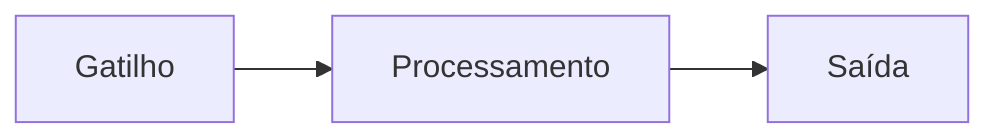

# SOLUTION_DESIGN

> Arquitetura técnica da solução. Saída do `/planejar-automacao`.

## Visão geral

[Diagrama Mermaid ou descrição em prosa do funcionamento ponta a ponta.]

## Stack escolhida

| Camada | Tecnologia | Por quê |
|---|---|---|
| Runtime | [Python 3.11 / Node 20] | |
| Framework principal | | |
| Agendamento | [cron / Render / Lambda / manual] | |
| Banco/persistência | | |
| IA (se aplicável) | | |
| Hospedagem | | |

## Decisões de arquitetura

> Decisões importantes ficam em ADRs separados — link aqui.

- [ADR-001 — Por que escolhemos X](./ADR/001-X.md)
- [ADR-002 — Por que não usar Y](./ADR/002-Y.md)

## Integrações

| Sistema | Direção | O que troca | Frequência |
|---|---|---|---|
| | leitura/escrita/ambos | | |

## Pontos críticos

[Onde uma falha trava o fluxo todo. Tudo depende daqui? Single point of failure?]

## Segurança

- **Credenciais:** [como são armazenadas]
- **Dados sensíveis:** [LGPD — que tipo, retenção, anonimização]
- **Acessos:** [quem tem]

## Observabilidade

- **Logs:** estruturados em JSON, exportados pra [destino]
- **Métricas:** [o que monitorar]
- **Alertas:** [quando alertar, em que canal]

## Plano de evolução

[O que vem depois do MVP. Pode ser escala, novas features, otimizações.]

---

## Mudanças nesta versão

[Quando atualizar, adicionar entrada com data e o que mudou.]

### YYYY-MM-DD
- [mudança]
